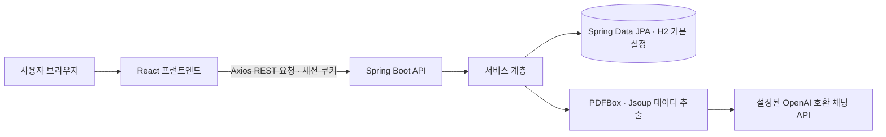

# HireSync

HireSync는 채용 공고를 조회·관리하고 PDF와 웹 페이지에서 공고 정보를 추출하는 웹 애플리케이션입니다. 아래 내용은 저장소 코드와 설정에서 확인했습니다.

## 주요 기능

- 채용 공고 목록·상세 조회, 검색·정렬·페이지 처리
- PDF 텍스트를 추출하고 AI API로 공고 항목 구조화
- URL 페이지 텍스트 수집 및 채용 정보 가져오기
- 공고 등록·수정·삭제 및 상태 관리 API
- 사용자 가입·로그인·로그아웃, 관리자용 사용자·API 사용 로그 기능
- 브라우저와 백엔드 사이의 세션 쿠키 기반 인증

> 실제 배포 주소와 운영 중인 서비스 상태는 저장소만으로 확인할 수 없습니다.

## 전체 아키텍처

자세한 내용은 [아키텍처 문서](docs/architecture/README.md)를 참고하세요.

## 기술 스택

| 영역 | 저장소에서 확인한 기술 |
| --- | --- |
| 백엔드 | Java 21, Spring Boot 3.5.0, Spring Security, Spring Data JPA, Spring AI |
| 데이터베이스 | H2 기본 설정, PostgreSQL JDBC 런타임 의존성 포함 |
| 문서·웹 추출 | Apache PDFBox 3.0.1, Jsoup 1.17.2, Selenium 4.20.0 |
| 프런트엔드 | React 19, React Router 7, Axios, CSS |
| 테스트·자동화 | Spring Boot Test(JUnit 5 계열), Playwright, GitHub Actions |
| 빌드·컨테이너 | Gradle Wrapper, npm, 백엔드 Dockerfile |

백엔드 버전은 `0.0.1-SNAPSHOT`, 프런트엔드 패키지 버전은 `0.1.0`입니다. 통합 릴리스 버전은 확인되지 않았습니다.

## 문서

- [설치 및 개발](docs/development/README.md)
- [아키텍처 및 데이터 흐름](docs/architecture/README.md)
- [운영·CI/CD·배포](docs/operations/README.md)
- [로드맵 및 버전](docs/roadmap/README.md)

## 저장소 구성

- `backend/`: Spring Boot API 및 비즈니스 로직
- `frontend/`: React 브라우저 애플리케이션
- `tests/`: Playwright 테스트
- `specs/`: 기능·API 명세 및 작업 계획
- `docs/`: 프로젝트 문서
