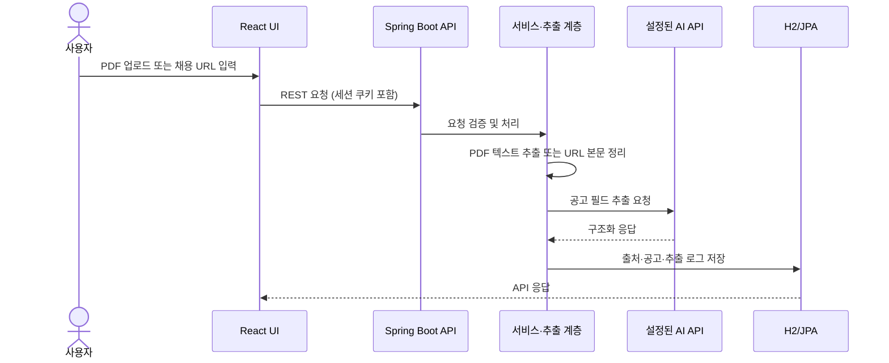

# 아키텍처 및 데이터 흐름

## 구성 요소

| 구성 요소 | 역할 | 코드 위치 |
| --- | --- | --- |
| React UI | 로그인, 공고 조회·등록·수정, 사용자 관리 화면 | `frontend/src/pages/`, `frontend/src/App.js` |
| API 클라이언트 | Axios 요청, 세션 쿠키 포함, 인증 오류 처리 | `frontend/src/services/api.js` |
| REST API | 인증, 공고, PDF 분석, URL 가져오기, 사용자·사용량 로그 | `backend/src/main/java/com/hiresync/controllers/` |
| 서비스 계층 | 공고 관리, URL 수집, PDF 분석, 사용자·로그 처리 | `backend/src/main/java/com/hiresync/services/` |
| 추출·영속성 | PDFBox/Jsoup, AI API 호출, JPA 저장소 | `backend/src/main/java/com/hiresync/extraction/`, `repositories/` |
| 데이터 저장 | 기본 H2 데이터베이스 및 JPA 모델 | `backend/src/main/resources/application.properties`, `models/` |

## 주요 데이터 흐름

## 코드에서 확인한 동작

- Axios는 `withCredentials: true`를 사용하고 백엔드 CORS 설정은 지정 출처에서 자격 증명을 허용합니다.
- Spring Security는 필요한 경우 세션을 만들며 로그인 API는 `/api/v1/auth` 아래에 있습니다.
- PDF 업로드 경로는 `/api/v1/sources/pdf`; PDFBox로 텍스트를 읽고 AI 응답을 공고 데이터로 파싱해 저장합니다.
- URL 수집에는 Jsoup이 사용됩니다. 사람인 URL 메타데이터 추출·변환 로직도 있습니다.
- `JobPosting`, `User`, `Source`, `ExtractionLog`, `ApiUsageLog` 등 JPA 모델과 저장소가 있습니다.
- 기본 DB는 인메모리 H2이고 `schema.sql` 초기화가 활성화되어 있습니다. PostgreSQL 드라이버는 있지만 운영 PostgreSQL 구성은 확인되지 않았습니다.

## 설정 파일

- `backend/build.gradle`: 백엔드 의존성과 버전
- `backend/src/main/resources/application.properties`: 포트, DB, AI API, 업로드 크기
- `frontend/src/services/api.js`: API 주소와 세션 요청
- `specs/001-job-info-service/contracts/`: API 계약 문서
